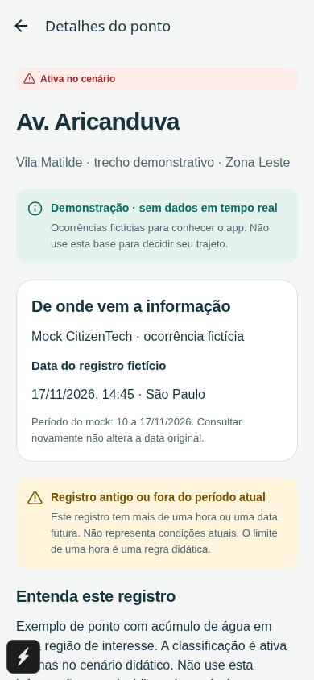
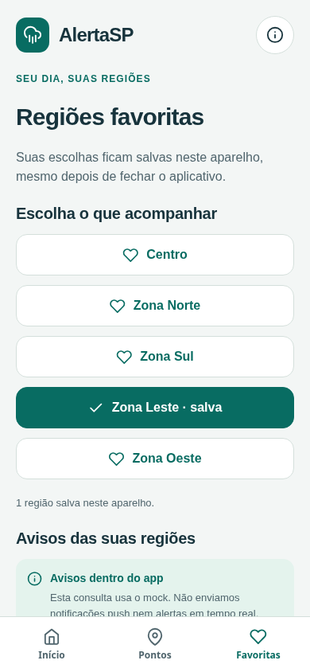
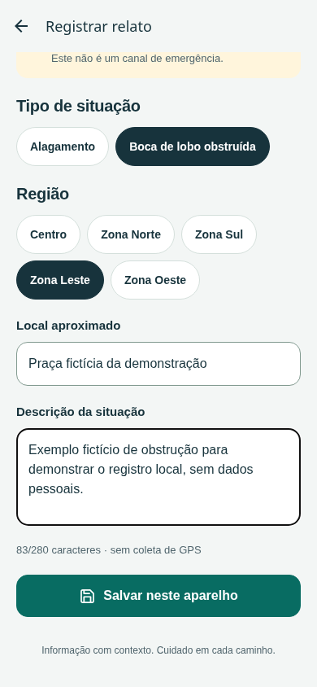

# AlertaSP · CitizenTech

Aplicativo para ajudar pessoas que circulam por São Paulo a consultar pontos de alagamento, entender a origem e a atualização da informação e acompanhar regiões favoritas.

Projeto da **Global Solution 2026.2 — FIAP · Mobile Development & IoT**, desenvolvido com **React Native, TypeScript, Expo e Expo Router**, com persistência em **SQLite**.

> **Demonstração acadêmica:** os dados fornecidos são fictícios e identificados como mock. O aplicativo não oferece monitoramento em tempo real. Ausência de registros não significa que uma rua esteja segura.

[Como executar](#como-executar) · [Ficha CitizenTech](#ficha-citizentech) · [Telas](#prints-das-telas) · [Vídeo](#vídeo-de-apresentação) · [Critérios de avaliação](#critérios-de-avaliação)

## Equipe

| Integrante | RM |
|---|---|
| Enzo Almeida | 556900 |
| Gabriel Mello | 554421 |
| Guilherme Moreira | 557290 |

## Vídeo de apresentação

**[Assistir ao vídeo do AlertaSP no YouTube — 55 segundos](https://www.youtube.com/shorts/xwy6e_qB4Qw)**

A gravação mostra o aplicativo em execução: consulta de pontos, filtros, detalhes, categorias, favoritas e registro de relato, incluindo manutenção dos dados após recarregar a aplicação. Duração exata: **54,68 segundos**, dentro do limite de 3 minutos.

**Plataforma da gravação: Expo web**, em viewport de 390 × 844, sem narração. A validação no Android Emulator está descrita no [guia de testes Android](docs/ANDROID-E-VIDEO.md) e permanece pendente.

Uma [cópia do vídeo para download](https://github.com/enzoalmeiida/alertasp-mobile/raw/refs/heads/main/docs/evidencias/demo-web.webm) também está disponível neste repositório, em formato WebM.

## Ficha CitizenTech

| Campo | Definição |
|---|---|
| Nome da solução | AlertaSP — CitizenTech |
| Cidade e bairros | São Paulo/SP, com exemplos demonstrativos em Cambuci, Vila Matilde e outras regiões da cidade. |
| Cidadão beneficiado | Pessoas que se deslocam pela cidade e precisam consultar informações sobre alagamentos de forma simples, sem conhecimento técnico. |
| Problema | É difícil encontrar informação localizada, atualizada e compreensível sobre pontos de alagamento antes de um deslocamento. |
| Como funciona | O cidadão consulta o resumo inicial, busca uma via ou região, abre os detalhes para conferir status, fonte e horário e salva regiões favoritas para acompanhar avisos. Também pode registrar um relato local. |
| Papel do Mobile | Oferecer a jornada de consulta, consumir o mock e salvar favoritas e relatos em SQLite. |
| Papel da SOA | Possível fornecimento futuro de dados por API. Este aplicativo funciona de forma independente, usando o mock documentado. |
| Papel do IoT | Representar uma leitura demonstrativa de sensor, identificada como simulada. Não há equipamento ou integração real implementados. |
| Repositório | [github.com/enzoalmeiida/alertasp-mobile](https://github.com/enzoalmeiida/alertasp-mobile) |
| Indicador de impacto proposto | Medir tempo e taxa de sucesso para localizar uma via e explicar corretamente fonte, status e data. Meta proposta: 4 de 5 participantes concluírem a tarefa em até 60 segundos. **Ainda não medido.** |
| ODS relacionados | **ODS 11**, especialmente 11.5: acesso à informação sobre riscos de desastres urbanos; **ODS 13**, especialmente 13.3: conscientização sobre eventos climáticos. |

A Ficha descreve o escopo do protótipo. O recorte territorial e o indicador são propostas para validação com cidadãos; não há resultados de pesquisa de campo ou redução de danos comprovados.

## Jornada e funcionalidades

1. **Início:** entender o resumo de ocorrências e identificar que os dados são demonstrativos.
2. **Pontos:** buscar por via/bairro e filtrar por região, sem depender de localização do aparelho.
3. **Detalhe:** conferir local, categoria, fonte e horário de atualização, com aviso quando o dado estiver antigo.
4. **Categorias:** distinguir ativa no cenário, histórico, relato pendente e leitura simulada de sensor.
5. **Favoritas:** salvar regiões e consultar seus avisos dentro do aplicativo.
6. **Relatar:** registrar um exemplo fictício de alagamento ou boca de lobo obstruída, consultar o registro salvo e excluí-lo com confirmação.

A consulta principal usa uma **lista pesquisável**. Não há mapa, solicitação de GPS ou chave de serviço cartográfico. Os avisos são exibidos no app; não são notificações push. Relatos ficam no dispositivo e não são enviados a autoridades.

| Rota Expo Router | Tela |
|---|---|
| `/` | Início |
| `/pontos` | Consulta e categorias |
| `/ocorrencia/[id]` | Detalhe da ocorrência ou relato |
| `/favoritas` | Regiões favoritas e avisos |
| `/relatar` | Formulário de relato |
| `/sobre` | Fontes, privacidade e cenários de demonstração |

O [plano do produto](docs/PLANO.md) reúne wireframes e a matriz requisito → tela/fluxo → dado → evidência.

## Como executar

### Requisitos

- Git, **Node.js 24.22.1** (versão registrada em `.nvmrc`) e **npm 11.9.0**.
- Para Android: Android Studio, Android SDK Platform Tools e um dispositivo virtual (AVD).
- **Expo Go compatível com o SDK 58**; consulte [expo.dev/go](https://expo.dev/go).

Versões de referência: Expo **58.0.26**, React Native **0.88.1**, React **19.3.0**, Expo Router **58.0.32**, expo-sqlite **58.0.18** e TypeScript **6.0.3**. O `package-lock.json` registra as versões instaladas.

### Android Emulator

```bash
git clone https://github.com/enzoalmeiida/alertasp-mobile.git
cd alertasp-mobile
npm ci
```

Abra o AVD pelo **Device Manager** do Android Studio e aguarde a inicialização. Confirme a conexão:

```bash
adb devices
```

Com o emulador listado como `device`, execute na pasta do projeto:

```bash
npm run android
```

Se o Expo Go disponível não suportar o SDK do projeto, consulte as orientações de development build no [guia Android](docs/ANDROID-E-VIDEO.md). Esse guia também contém o checklist de teclado, navegação, TalkBack e persistência.

**Não é necessário configurar backend, conta, chave de API ou arquivo `.env`.** Instalar dependências requer internet. O mock é local e não precisa de API externa; durante o desenvolvimento, o app precisa conseguir acessar o servidor Metro.

### Navegador

```bash
npm run web
```

A versão web usa SQLite com WebAssembly. Os headers COOP/COEP necessários estão configurados em `metro.config.js`; uma hospedagem da exportação web também precisa fornecê-los. Abrir o HTML diretamente como arquivo não é suficiente.

## Dados e banco de dados

### Consumo do mock

O serviço em `src/services/occurrences.ts` consome de forma assíncrona os **seis exemplos fictícios** de [src/data/occurrences.json](src/data/occurrences.json), valida os dados e oferece estados de carregamento, vazio e erro com nova tentativa.

As datas dos exemplos pertencem ao período de **10 a 17/11/2026** e não são renovadas artificialmente ao atualizar a tela. O app identifica informação desatualizada. Em **Sobre**, é possível selecionar os cenários normal, sem dados, falha e base antiga para demonstrar esses estados.

| Categoria | Significado no protótipo |
|---|---|
| Ativa | Ocorrência ativa **no cenário fictício**, não confirmação atual da situação da via |
| Histórico | Ocorrência inativa do mock, separada das ativas |
| Relato | Informação pendente e não validada; pode ser exemplo do mock ou registro local |
| Sensor | Leitura simulada, sem dispositivo IoT conectado |

Não há consumo de dados oficiais do CGE ou GeoSampa. Fonte, categoria e atualização aparecem nos detalhes para que o cidadão compreenda os limites da informação.

### Persistência SQLite

O banco local **`alertasp.db`**, acessado por `expo-sqlite`, possui as tabelas:

| Tabela | Informação persistida |
|---|---|
| `favorites` | Região favorita e data de inclusão |
| `reports` | Região, tipo, local, descrição e data do relato |

A implementação utiliza migração versionada, validação e consultas parametrizadas. Não coleta identidade, contatos, fotos ou localização do aparelho. Use apenas dados fictícios ao demonstrar o formulário.

**Como demonstrar a persistência:** salve uma região, registre um relato e consulte ambos. Encerre o aplicativo e reabra o mesmo projeto: a favorita e o relato devem permanecer. Depois, exclua o relato e confira a remoção. Não desinstale nem limpe os dados, pois essas ações apagam o banco. O [guia Android](docs/ANDROID-E-VIDEO.md#checklist-com-evidências) explica como encerrar o Expo Go para executar a verificação.

O [documento de dados e arquitetura](docs/DADOS-E-ARQUITETURA.md) detalha esquema, fontes técnicas e decisões de implementação.

## Acessibilidade

- Status comunicados por **texto, ícone e cor**, sem depender apenas da cor.
- Rótulos acessíveis em controles, indicação da região selecionada e mensagens de erro por campo.
- Alvos de toque de pelo menos 48 dp, texto escalável e telas roláveis.
- Estados claros de carregamento, ausência de resultados, erro e dado antigo.
- Consulta manual disponível sem solicitar geolocalização.

As verificações automatizadas web incluem axe com regras WCAG 2 A/AA e 2.1 AA em seis telas e viewport estreito de 320 × 640. **TalkBack, fonte ampliada e interação nativa ainda precisam de validação no Android**; testes web não substituem essa conferência.

## Prints das telas

Capturas reais do aplicativo em **Expo web/Chromium, viewport 390 × 844**.

| Início | Consulta por região | Detalhe |
|---|---|---|
|  |  |  |

| Favoritas | Formulário de relato | Persistência |
|---|---|---|
|  |  |  |

## Critérios de avaliação

Referência: página 34 do enunciado **GS CitizenTech — 3ES Fev — FIAP 2026**. São seis critérios, sem pesos individuais informados. O texto permite API **ou mock** e exige banco de dados sem determinar modalidade local ou remota. Este projeto utiliza mock e SQLite local; o enunciado disponível não exige mapa nem integração real com SOA/IoT.

| Critério | Implementação | Evidência |
|---|---|---|
| Telas e navegação | Abas, busca, categorias, detalhe, favoritas e formulário com Expo Router | Prints acima e testes da jornada web |
| Consumo de dados | Serviço assíncrono, mock identificado, fonte/data e tratamento dos estados da consulta | Arquivo de dados, tela Sobre e testes de cenários |
| Banco de dados | Inserção, consulta e exclusão em SQLite; manutenção após reabertura | Testes SQLite e persistência web; roteiro para repetir no Android |
| Acessibilidade | Rótulos, texto/ícone/cor, alvos de toque e mensagens claras | Verificações axe e tela estreita; checklist Android |
| Aderência ao problema | Consulta por via/região com fonte, status e atualização; favoritas e relatos | Ficha CitizenTech e jornada implementada |
| Documentação | Ficha, execução, arquitetura, prints e roteiro de apresentação | Este README, documentos vinculados e vídeo da aplicação em execução |

## Organização do código e testes

```text
src/app/          Telas e navegação Expo Router
src/components/   Componentes e estilos compartilhados
src/domain/       Tipos, filtros, datas e validação
src/data/         Dados fictícios identificados
src/services/     Serviço de consumo do mock
src/storage/      SQLite, migração e repositório de dados
src/state/        Estado de consultas e persistência
tests/            Testes de domínio, SQLite e navegador
docs/             Plano, arquitetura, validação e evidências
```

Após `npm ci`, execute:

```bash
npm run typecheck
npm run lint
npm test
```

Para os testes de navegador, instale o Chromium do Playwright. A configuração inicia o servidor web quando necessário:

```bash
npx playwright install chromium
npm run test:e2e
```

Para exportar a versão web:

```bash
npm run build:web
```

**Resultados registrados:** 8 testes de domínio/SQLite e 6 testes de navegador aprovados, além de lint, TypeScript e exportação dos bundles web/Android/iOS. A exportação não gera APK/IPA nem comprova execução nativa. Consulte o [relatório de validação](docs/VALIDACAO.md) e o [resultado dos testes web](docs/evidencias/testes-web.json).

## Checklist de entrega

- [x] Código organizado no GitHub, com React Native, TypeScript, Expo e Expo Router.
- [x] Consumo de mock documentado e persistência SQLite implementados.
- [x] README com Ficha CitizenTech, integrantes, instruções e prints.
- [x] Testes automatizados e limites da validação documentados.
- [ ] Executar o [checklist Android](docs/ANDROID-E-VIDEO.md) e registrar os resultados reais, incluindo persistência após encerramento e acessibilidade.
- [x] Vídeo de 54,68 segundos disponível na seção [Vídeo de apresentação](#vídeo-de-apresentação), com plataforma identificada.
- [x] Repositório e vídeo acessíveis publicamente, verificados sem autenticação.
- [ ] Um integrante enviar o link do repositório no **Teams até 19/11/2026 às 23h55, horário de São Paulo**.
