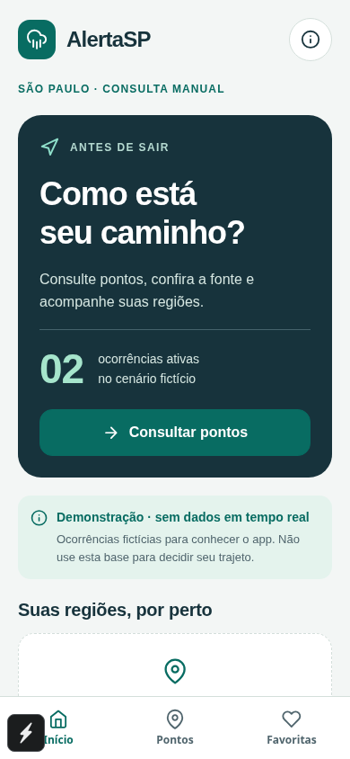
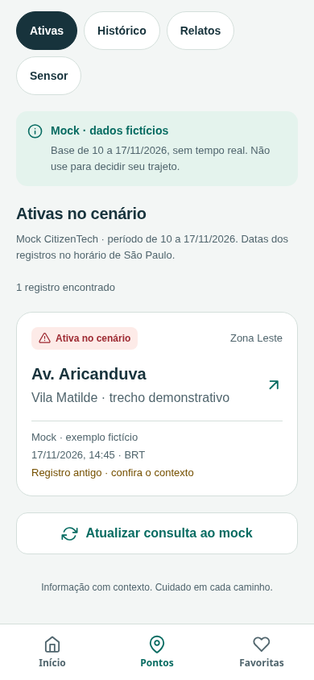
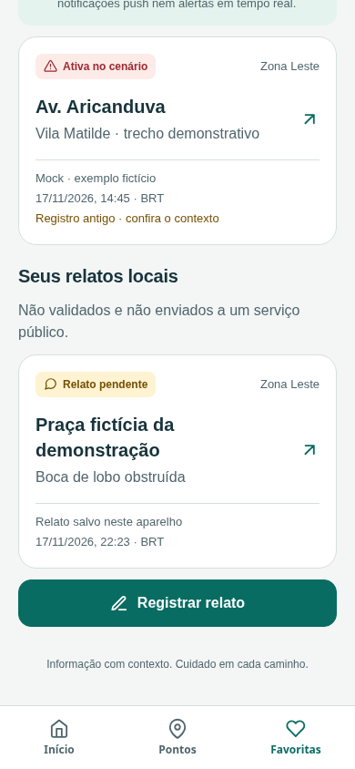

# AlertaSP Mobile · CitizenTech

Aplicativo Expo/React Native/TypeScript para consultar pontos de alagamento por região em São Paulo, compreender origem/data/status e guardar favoritas e relatos locais. **Protótipo demonstrativo: todos os pontos fornecidos são fictícios, sem dados em tempo real.**

## Ficha da CitizenTech

| Campo | Definição |
|---|---|
| Nome | AlertaSP — CitizenTech |
| Cidade e bairro | São Paulo/SP; recorte demonstrativo com Cambuci, Vila Matilde e outras regiões. O recorte final deve ser validado pela pesquisa da equipe. |
| Cidadão beneficiado | Pessoas que se deslocam pela cidade e precisam compreender informações localizadas de alagamento, sem conhecimento técnico. |
| Problema, em uma frase | É difícil encontrar informação localizada, atualizada e compreensível sobre pontos de alagamento antes de um deslocamento. |
| Como funciona | Início → buscar via/região → conferir categoria, fonte e data → salvar região → consultar avisos. Opcionalmente, registrar um relato local não validado. |
| O que cada parte faz | Mobile: navegação, consumo do mock e persistência SQLite. SOA: futura fonte por contrato, independente deste MVP. IoT: leitura simulada identificada, sem equipamento real ou integração implementada. |
| Repositório | [enzoalmeiida/alertasp-mobile](https://github.com/enzoalmeiida/alertasp-mobile) |
| Indicador de impacto | Proposta: medir tempo e taxa de sucesso para localizar uma via e explicar corretamente fonte/status/data. Meta de estudo: 4 de 5 participantes concluírem em até 60 segundos. **Meta proposta, não resultado medido.** |
| ODS conectados | ODS 11, especialmente 11.5: apoiar o acesso a informações sobre riscos de desastres urbanos; ODS 13, especialmente 13.3: apoiar conscientização sobre eventos climáticos. O protótipo não comprova redução de danos. |

Equipe:

- Enzo Almeida — RM556900
- Gabriel Mello — RM554421
- Guilherme Moreira — RM557290

A Ficha foi estruturada com o contexto fornecido pela equipe. Entrevistas, observações de campo e resultados de impacto **não foram inventados** e ainda precisam ser documentados pela equipe.

## Requisitos e rubrica

Referência: PDF **GS CitizenTech — 3ES Fev — FIAP 2026**, página 34; Ficha e combinados nas páginas 20–21. O PDF exige Expo, React Native/TypeScript, Expo Router, API **ou mock**, banco e acessibilidade. Não especifica banco local/remoto nem pesos individuais. **A rubrica completa do Teams não foi fornecida**; confirmar com o professor se SQLite local é aceito e se há exigências adicionais.

| Critério | Implementação e evidência | Limite da verificação |
|---|---|---|
| Telas e navegação | Três abas, detalhes por ID, formulário, Sobre e rota inexistente; [wireframes e matriz](docs/PLANO.md) | Navegação web testada; gestos/back nativos pendentes |
| Consumo de dados | Serviço assíncrono com mock validado, pesquisa, filtros, loading, vazio, erro/retry, dado antigo | Sem API oficial; mock não é tempo real |
| Banco de dados | SQLite real, favoritas e relatos, migração, SQL parametrizado, inserir/consultar/excluir/reabrir | Persistência testada em Node/SQLite e Expo web; Android pendente |
| Acessibilidade | Texto + ícone + cor, contraste, rótulos, alvos de 48dp+, erros claros, fonte escalável | Axe web e tela estreita testados; TalkBack/fonte ampliada Android pendentes |
| Aderência ao problema | Consulta por via/região, data e fonte; histórico/pendente/sensor separados | Validação com cidadãos ainda não realizada |
| Documentação | Ficha, setup, arquitetura, fontes, limites, [prints](#prints-das-telas), [vídeo](#vídeo) e [prompts](prompts.md) | Conferir rubrica, completar evidências Android e entrega Teams |

Não há pesos ou nota estimados. Implementar um item não garante sua avaliação sem conferir a tarefa completa.

## Rodar no Android Emulator do computador

Versões: Node **24.22.1** (`.nvmrc`), npm **11.9.0**, Expo **58.0.26**, React Native **0.88.1**, React **19.3.0**, Expo Router **58.0.32**, expo-sqlite **58.0.18**, TypeScript **6.0.3**. O lockfile fixa as dependências efetivamente instaladas.

1. Instale Node/npm e Android Studio com SDK Platform Tools e um AVD.
2. Abra o emulador no Device Manager. Confirme que `adb devices` o lista como `device`.
3. Na raiz do repositório:

```bash
npm ci
npm run android
```

Use **Expo Go compatível com o SDK 58**; confira [expo.dev/go](https://expo.dev/go). Não troque versões de dependências para encaixar um Expo Go antigo. Se necessário, a equipe pode usar uma development build, com a toolchain Android correspondente. Veja o [guia Android e checklist manual](docs/ANDROID-E-VIDEO.md).

Não há backend, conta, chave, permissão de localização ou variável de aplicação obrigatória. Consultas são manuais. O mock funciona sem internet após carregar o app; instalação de pacotes e conexão com o Metro ainda exigem acesso apropriado.

Para web:

```bash
npm run web
```

SQLite web requer WebAssembly e os headers COOP/COEP já configurados em `metro.config.js`. Uma futura hospedagem também precisa desses headers; abrir o HTML exportado diretamente como arquivo não basta.

## Jornada e rotas

| Rota | Finalidade |
|---|---|
| `/` | Entender o resumo e acessar a consulta |
| `/pontos` | Buscar via/bairro, filtrar região e alternar Ativas/Histórico/Relatos/Sensor |
| `/ocorrencia/[id]` | Conferir local, status, fonte e data; favoritar região; excluir relato próprio com confirmação |
| `/favoritas` | Salvar/remover regiões, consultar avisos internos e relatos locais |
| `/relatar` | Validar e inserir relato fictício, com confirmação de gravação |
| `/sobre` | Entender fonte/limites/privacidade e demonstrar cenários normal, vazio, erro e antigo |

A lista é a consulta principal e a alternativa ao mapa. **Não há mapa geográfico, GPS ou cobrança de serviço cartográfico.** Se a rubrica completa exigir mapa, esse requisito ainda precisa ser implementado com biblioteca/provedor compatíveis e condições de chave/custo verificadas.

## Dados, persistência e privacidade

- Fonte: `src/data/occurrences.json`, seis exemplos fictícios, período de **10 a 17/11/2026**. As datas não são atualizadas artificialmente quando a consulta é refeita.
- Nenhum dado é oficial do CGE/GeoSampa. Não presumimos endpoint não documentado.
- “Ativa” significa ativa no cenário; histórico é inativo; relato é pendente/não validado; sensor é simulado.
- Banco `alertasp.db`: tabelas `favorites` e `reports`, migração versionada, validação e consultas parametrizadas. Dados ficam neste aparelho/navegador, sem envio.
- A aplicação não coleta GPS, identidade, contatos ou fotos. Use exemplos fictícios no formulário. Avisos são consultas internas, não notificações push.
- Não encontrar registros **não significa rua segura**. O app não substitui orientações oficiais e não é canal de emergência.

Leia [dados e arquitetura](docs/DADOS-E-ARQUITETURA.md) para esquema, fluxo, fontes técnicas, custos de um eventual mapa e limites.

Para demonstrar banco: salve uma região, crie um relato, consulte ambos, encerre o app e reabra o mesmo projeto. As informações devem continuar disponíveis. Não desinstale nem limpe dados: isso apaga o banco. [Roteiro detalhado](docs/ANDROID-E-VIDEO.md).

## Organização e testes

```text
src/app/          Rotas Expo Router
src/components/   Componentes acessíveis e estilos compartilhados
src/domain/       Tipos, filtros, datas e validação
src/data/         Mock identificado
src/services/     Adaptador assíncrono de consumo
src/storage/      SQLite, migração e repositório
src/state/        Coordenação de consultas e persistência
tests/            Domínio, SQLite real e testes de navegador
docs/             Plano, evidências, arquitetura e roteiro Android/vídeo
```

```bash
npm run typecheck
npm run lint
npm test
npm run build:web -- --max-workers 2
npx expo export --platform all --output-dir dist --max-workers 2
```

O último comando gera bundles de web, Android e iOS; **não gera APK/IPA nem prova execução em dispositivo**.

Testes de navegador (com o Metro iniciado ou iniciado automaticamente pelo teste):

```bash
npx playwright install chromium
npm run test:e2e
```

A suíte cobre busca/categorias/detalhe, persistência SQLite após fechar e reabrir página, validação/exclusão, erro/vazio/antiguidade, checks WCAG A/AA nas seis telas e viewport estreito. São testes **web**, não Android. Os testes de Node fecham/reabrem um arquivo SQLite real e verificam inclusive textos com apóstrofos. [Resultados e limites](docs/VALIDACAO.md).

## Prints das telas

Capturas reais de **Expo web em Chromium, viewport 390 × 844**. Não são capturas do Android Emulator.

| Início | Consulta por região | Detalhe |
|---|---|---|
|  |  |  |

| Favoritas | Formulário de relato | Persistência após recarregar |
|---|---|---|
|  |  |  |

## Vídeo

[Assistir/baixar a demonstração Expo web](docs/evidencias/demo-web.webm) — gravação automatizada, sem narração e com menos de 3 minutos. Mostra o aplicativo real em execução, navegação, categorias, favoritas, relato e manutenção após recarregamento web. **Não é uma gravação Android e não comprova reinício nativo.**

Para reproduzir a captura, deixe o Metro em execução, instale os componentes do Playwright com `npx playwright install chromium ffmpeg` e execute `npm run capture:demo`. O script gera capturas de uma sessão isolada com dados fictícios.

A equipe deve completar a validação no Android e preferencialmente apresentar uma gravação narrada no emulador. [Roteiro final de 2min50s e checklist](docs/ANDROID-E-VIDEO.md). Confirme que o professor consegue abrir o repositório e o vídeo.

## Ambiente Codex na nuvem

Cada tarefa já é isolada: use o checkout existente, sem criar worktrees. Cache e SQLite web precisam de diretórios graváveis; o modo offline abaixo dispensa chamadas à API do Expo, mas não o acesso ao registry npm.

```bash
cd /workspace/alertasp-mobile
export npm_config_cache=/workspace/.cache/npm
export XDG_CACHE_HOME=/workspace/.cache
export EXPO_NO_TELEMETRY=1
export EXPO_OFFLINE=1
npm ci --engine-strict --no-audit --no-fund
CI=0 BROWSER=none npm run web -- --localhost --port 8081 --max-workers 2
```

Nesta imagem há Chromium do sistema. Para testes, use `PLAYWRIGHT_CHROMIUM_EXECUTABLE_PATH=/usr/bin/chromium npm run test:e2e`. O runtime cloud não contém Android SDK/AVD/KVM; não foi instalado um emulador sem capacidade adequada de executá-lo.

## O que ainda impede declarar a entrega completa

- Conferir a rubrica do Teams: aceitação de SQLite local e eventual requisito adicional de mapa/integração; não há pesos individuais no PDF.
- Executar a jornada no **Android Emulator**, incluindo encerrar/reabrir, teclado, botão voltar, TalkBack e fonte grande; registrar versão e resultados.
- Completar evidências Android e conferir o link do vídeo com acesso do avaliador.
- Validar a Ficha/recorte com a pesquisa real da equipe e medir o indicador proposto, sem fabricar entrevistas ou resultados.
- Um integrante enviar o link no **Teams até 19/11/2026 às 23h55, horário de São Paulo**. O envio não foi realizado por esta automação.
