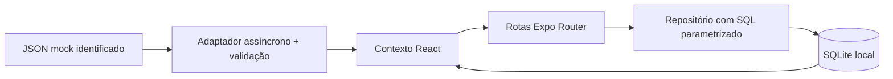

# Dados, arquitetura e decisões

## Fluxo de ponta a ponta



As telas não executam SQL. `src/services/occurrences.ts` lê `src/data/occurrences.json`, simula latência e valida o contrato antes de entregar os dados. `src/domain/model.ts` contém tipos, filtros, datas e regras de validação. `src/storage/repository.ts` contém migração e operações. `src/state/AppContext.tsx` coordena dados assíncronos, persistência e erros, descartando respostas de consultas obsoletas. Os componentes reutilizados ficam fora de `src/app`.

## Fonte: mock, sem endpoint presumido

Seis exemplos inventados pela implementação CitizenTech, datados de 10 a 17/11/2026. Vias reais são usadas apenas como referências geográficas; os registros **não comprovam alagamentos reais**. Um relato criado no app tem origem `local-report`, status pendente e data real da gravação. Seu conteúdo deve ser fictício para a apresentação.

O contrato mantém `id`, `location`, `neighborhood`, `region`, `category`, `origin`, `source`, `updatedAt`, `description` e `sensorReading` opcional. O mock valida campos, região/categoria, IDs duplicados, data e origem. Categorias nunca são inferidas somente pela cor. Sensores e relatos não entram na contagem de ocorrências ativas.

O botão “Atualizar consulta ao mock” repete a leitura, mas não troca a data do registro por “agora”. Registros com mais de uma hora (ou data futura/inválida) são marcados como antigos/fora do período. Esse limite é didático e não uma regra oficial do CGE. As datas são exibidas em `America/Sao_Paulo`.

Para integrar uma API depois, documente antes URL, método, autenticação, licença, paginação, limites, período e significado dos campos. Crie outro adaptador/contrato que distinga dado oficial de relato e simulação. Não aponte o mock para uma API inventada do CGE/GeoSampa nem remova o rótulo de demonstração sem substituir efetivamente a fonte.

## SQLite e manutenção após reinício

Arquivo: `alertasp.db`; versão de esquema: 1 (`PRAGMA user_version`). A migração é transacional e não apaga dados existentes. Uma versão futura desconhecida é recusada. As escritas de usuário usam parâmetros, inclusive textos com apóstrofos.

```sql
favorites(region TEXT PRIMARY KEY, created_at TEXT NOT NULL)
reports(id INTEGER PRIMARY KEY AUTOINCREMENT,
        region TEXT NOT NULL, kind TEXT NOT NULL,
        location TEXT NOT NULL, description TEXT NOT NULL,
        created_at TEXT NOT NULL)
```

O esquema real acrescenta `CHECK` para regiões/tipos permitidos e tamanhos dos textos. Favoritas não duplicam. Relatos podem ser inseridos, consultados e excluídos com confirmação; não há envio, validação comunitária ou edição implementada. Dados permanecem após fechar/reabrir, mas não após desinstalar/limpar armazenamento.

Android/iOS usam `expo-sqlite` nativo. Web usa o SQLite WebAssembly da mesma biblioteca com persistência no armazenamento do navegador; não há fallback silencioso para memória nem `localStorage` apresentado como banco. A configuração Metro fornece suporte WASM e os headers `Cross-Origin-Embedder-Policy: credentialless` e `Cross-Origin-Opener-Policy: same-origin`. Em hospedagem web, esses headers também precisam existir no servidor; abrir `dist/index.html` como arquivo não é suficiente. O alvo prioritário da equipe continua Android.

Testes unitários usam SQLite real via `node:sqlite` e o mesmo repositório/migração. Testes de navegador usam `expo-sqlite`, salvam dados, fecham a página e abrem outra na mesma sessão. Isso prova os caminhos exercitados, mas não substitui o force-stop/reabertura no Android.

## Mapa, permissões e custos

O MVP usa **lista pesquisável**, aceita pela jornada “mapa/lista” indicada pela equipe. A página 34 não exige mapa. Não há biblioteca cartográfica, permissão de localização ou chave de API; não se assume gratuidade de Google Maps. A lista também funciona como alternativa caso um mapa futuro falhe.

Se a rubrica do Teams exigir mapa geográfico, considerar `react-native-maps` somente após conferir a compatibilidade com o SDK 58 e o binário escolhido. O provedor Google no Android pode exigir chave, ativação de SDK, projeto de faturamento e restrição por pacote/assinatura; preços/cotas precisam ser confirmados na conta e documentação vigentes. Isso é trabalho adicional não implementado. Exibir marcadores fornecidos pela base não requer acesso ao GPS do usuário; “perto de mim” exigiria finalidade explícita, consentimento e alternativa manual.

## Acessibilidade e cuidado com dados

Texto de status + ícone + cor; contraste da paleta verificado automaticamente na web; botões/chips com altura mínima de 48dp; fonte escalável; conteúdo rolável; rótulos nos campos/ícones acionáveis; aba e seleção indicadas; erros junto aos campos; confirmação de gravação/exclusão; avisos de fonte e antiguidade. TalkBack, escala de fonte do Android e teclado real ainda requerem teste nativo.

Não há GPS, login, foto, telefone, telemetria de produto ou backend. A equipe deve usar apenas exemplos fictícios. Relatos não são chamados de emergência. Ausência de ocorrência não significa “rua segura”.

## Referências técnicas consultadas

- Expo Router: [instalação oficial](https://docs.expo.dev/router/installation/); fonte oficial consultada no repositório Expo em `docs/pages/router/installation.mdx` (inclui orientações SDK 58).
- SQLite SDK 58: [documentação](https://docs.expo.dev/versions/v58.0.0/sdk/sqlite/); fonte oficial consultada na branch `sdk-58`, `docs/pages/versions/unversioned/sdk/sqlite.mdx` e diff de configuração Metro.
- Os tipos instalados de Expo Router e expo-sqlite foram conferidos com TypeScript. O domínio `docs.expo.dev` estava bloqueado no runtime; as fontes públicas oficiais no GitHub estavam disponíveis. Nenhuma verificação TLS/checksum foi desativada.
